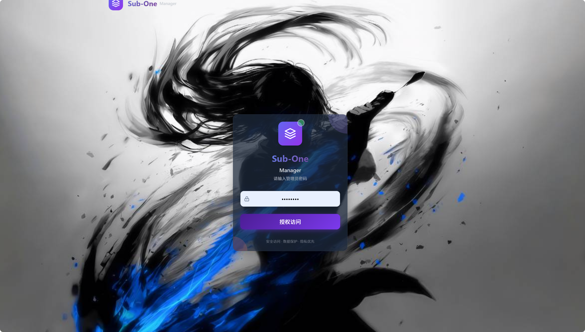
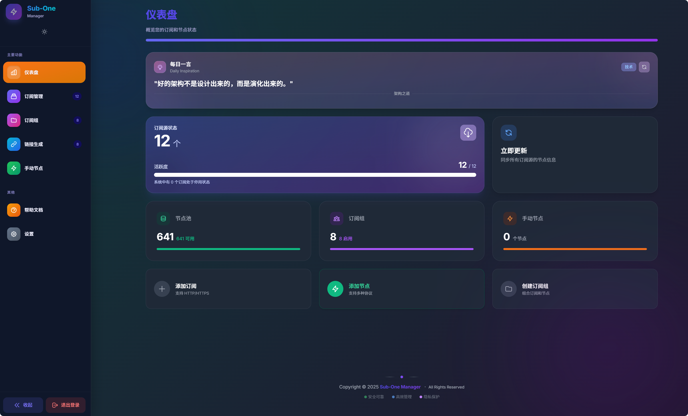
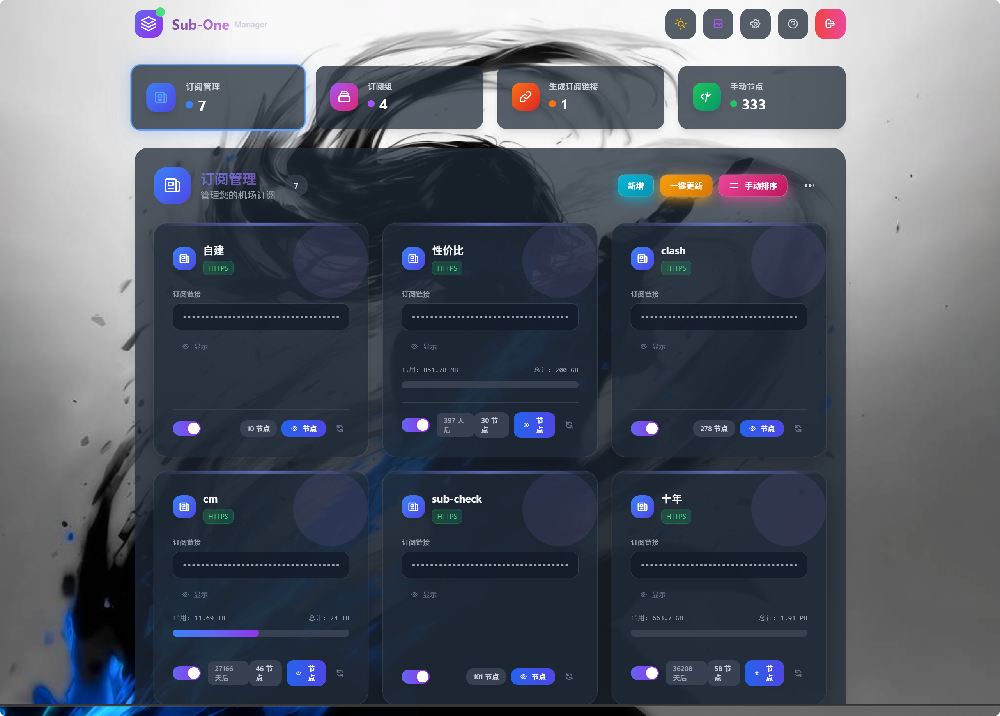
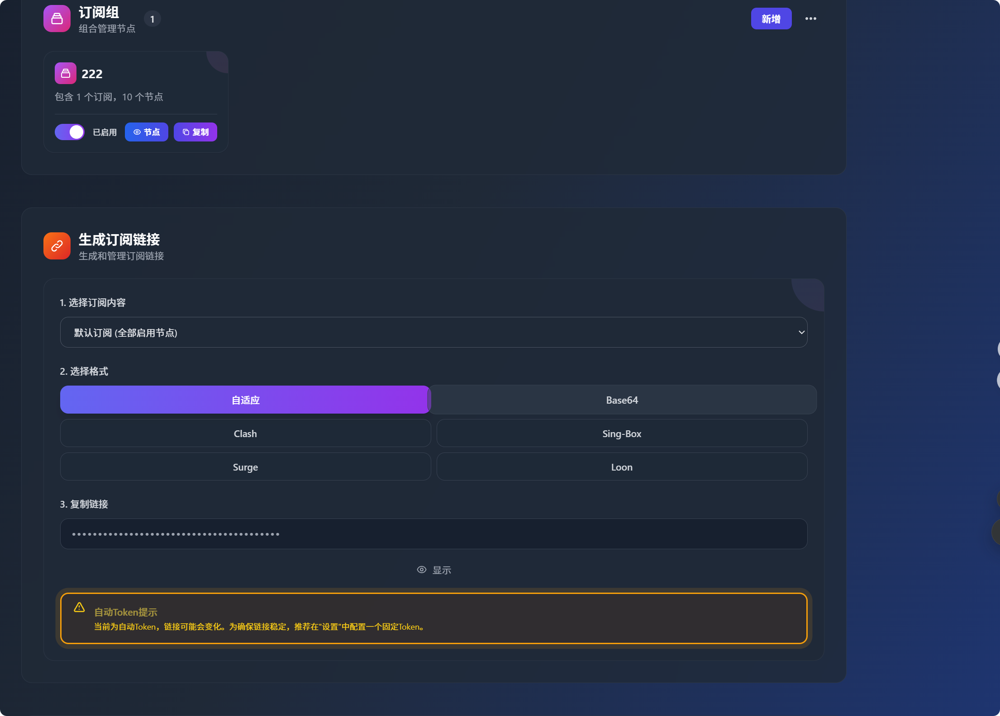
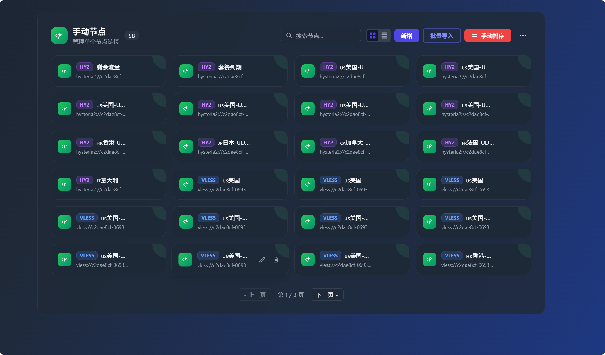

# Sub-One Manager

> 🚀 A modern network subscription management and conversion platform based on Vue 3, specifically designed for Cloudflare Pages and lightweight private containers.

[](https://github.com/binbankm/Sub-One/releases)
[](https://vuejs.org/)
[](https://www.typescriptlang.org/)
[](https://tailwindcss.com/)
[](https://pages.cloudflare.com/)
[](https://github.com/binbankm/Sub-One/pkgs/container/sub-one)
[](LICENSE)

[简体中文](README.md) | **English**

---

## 🌟 Preview



<details>
<summary>🖼️ Click to expand more screenshots</summary>

### 🔐 Authentication & Initialization


*Clean and secure login interface, automatically prompting administrator creation on first setup*

### 📋 Subscription Management


*Responsive grid layout supporting batch management and real-time status monitoring*

### 👥 Profile Aggregation


*Powerful aggregation panel supporting multi-source node reordering and custom rule filtering*

### ⚙️ Node Management


*Individual node viewer and batch import tool supporting quick parsing across protocols*

</details>

---

## ✨ Key Features

| Module | Feature Description |
| :--- | :--- |
| ⚡ **Built-in Conversion Engine** | Completely eliminates dependence on external Subconverter instances; all parsing and conversions run locally or inside Workers with zero data leakage and zero third-party latency |
| 🔄 **Dual Conversion Modes** | Supports both high-performance built-in engines and external conversion APIs, balancing enterprise security with advanced customization |
| 💾 **Dual Storage Engines** | Native support for **Cloudflare KV** (sub-millisecond reads) and **Cloudflare D1** (SQL relational database) with zero-downtime automated migrations from the dashboard |
| 🔐 **Modern Authentication** | Replaces static environment variables with intuitive first-time setup and secure SHA-256 + JWT token multi-account authentication |
| 🔗 **Short Links & Distribution** | Built-in short link generation and universal client format export for clean and effortless subscription distribution |
| 📱 **Full-Device Responsive UI** | Built with Vue 3 + Tailwind CSS, beautifully optimized across desktop widescreen, tablets, and mobile devices with native dark mode |

---

## 🚀 Deployment Guide

Sub-One Manager supports two deployment strategies: **Cloudflare Pages (Serverless, Recommended)** and **Docker (Private VPS)**.

### Strategy A: Cloudflare Pages Deployment (Recommended · Free · Global CDN)

No server required. Enjoy instant global distribution powered by Cloudflare edge network.

#### 1. Fork the Repository

Click the **Fork** button in the upper right corner to copy this repository to your personal GitHub account.

#### 2. Create a Pages Project in Cloudflare

1. Log in to the [Cloudflare Dashboard](https://dash.cloudflare.com/).
2. Navigate to **Workers & Pages** → **Pages**.
3. Click **Create application** → select **Connect to Git**.
4. Choose the forked `Sub-One` repository and set the build configurations:
   - **Framework preset**: `Vue`
   - **Build command**: `npm run build`
   - **Build output directory**: `dist`
   - **Root directory**: Leave blank (default is repository root)

#### 3. Configure Storage Bindings (Crucial Step)

The project supports KV and D1 storage backends. KV binding is mandatory for first use:

##### Bind KV Namespace (Required)

1. In the Cloudflare Dashboard, go to **Workers & Pages** → **KV**, and click **Create a namespace** (e.g., `sub-one-kv`).
2. Return to your Pages project: **Settings** → **Functions** → **KV namespace bindings** → click **Add binding**:
   - **Variable name**: `SUB_ONE_KV` (*must be exact uppercase*)
   - **KV namespace**: Select the namespace you just created.

##### Bind D1 Database (Optional, ideal for large node collections and SQL queries)

1. Navigate to **Workers & Pages** → **D1** → **Create database** named `sub-one-d1`.
2. In the database's **Console** tab, execute the SQL script in `db/init.sql` to initialize schema:

   ```sql
   CREATE TABLE IF NOT EXISTS storage (
       key TEXT PRIMARY KEY,
       value TEXT NOT NULL,
       updated_at INTEGER NOT NULL
   );
   CREATE INDEX IF NOT EXISTS idx_updated_at ON storage(updated_at);
   CREATE INDEX IF NOT EXISTS idx_key_prefix ON storage(key);
   INSERT OR REPLACE INTO storage (key, value, updated_at)
   VALUES ('_db_initialized', '"true"', strftime('%s', 'now') * 1000);
   ```

3. Return to Pages project **Settings** → **Functions** → **D1 database bindings** → click **Add binding**:
   - **Variable name**: `SUB_ONE_D1` (*must be exact uppercase*)
   - **D1 database**: Select your created database.

> [!TIP]
> Once configured, you can seamlessly switch between KV and D1 anytime in **Settings** → **Storage Backend**. All subscriptions, profiles, and accounts will be automatically migrated without manual exports!

#### 4. First Visit & Initialization

1. Once deployment succeeds, open your assigned `https://your-project.pages.dev` domain.
2. The system will detect first-time launch and automatically direct you to the **Create Administrator Account** page.
3. Choose a custom username and password (at least 6 characters) and submit to access the dashboard.

---

### Strategy B: Docker / VPS Deployment (Lightweight Container)

Ideal for users with their own VPS who prefer local data ownership. Data is persisted to `./data/kv.json`.

#### 1. Quick Start via Docker Compose (Recommended)

Download the pre-configured `docker-compose.yml`:

```bash
# Download compose file
curl -O https://raw.githubusercontent.com/binbankm/Sub-One/main/docker-compose.yml

# Start service
docker-compose up -d
```

Or manually create `docker-compose.yml`:

```yaml
version: '3.8'
services:
  sub-one:
    image: ghcr.io/binbankm/sub-one:latest
    container_name: sub-one
    ports:
      - '3055:3055'
    volumes:
      - ./data:/app/data
    restart: unless-stopped
    environment:
      - PORT=3055
      - TZ=Asia/Shanghai
```

#### 2. Single-line Command via Docker Run

```bash
docker run -d \
  --name sub-one \
  --restart unless-stopped \
  -p 3055:3055 \
  -v $(pwd)/data:/app/data \
  -e PORT=3055 \
  ghcr.io/binbankm/sub-one:latest
```

> [!IMPORTANT]
> The container listens on port `3055` by default. Always mount the `/app/data` volume to guarantee persistent storage of subscriptions and credentials across updates.

---

### Strategy C: Local Development & Build

```bash
# 1. Clone the repository
git clone https://github.com/binbankm/Sub-One.git
cd Sub-One

# 2. Install dependencies
npm install

# 3. Start local development server (with HMR)
npm run dev

# 4. Build production bundle
npm run build

# 5. Preview production build
npm run preview
```

---

## 🏗️ Architecture & Project Structure

<details>
<summary>📁 Click to expand full source architecture tree</summary>

```text
Sub-One/
├── src/                         # Frontend application source
│   ├── assets/                 # Static media and icons
│   ├── components/              # Shared UI and business components (Charts, Modals, etc.)
│   ├── composables/            # Vue composable business logic
│   ├── features/               # Core feature modules (Dashboard, Nodes, Profiles, Settings)
│   ├── pages/                  # Top-level route pages (LoginPage, DashboardPage)
│   ├── stores/                 # State management (Pinia)
│   ├── types/                  # Global TypeScript type definitions
│   ├── utils/                  # Frontend utilities
│   ├── App.vue                 # Root component
│   └── main.ts                 # Frontend entry point
├── lib/                         # Backend business logic library
│   └── backend/                # Pure TypeScript backend implementation
│       ├── api/               # API routes and request handlers
│       ├── config/            # Global constants and defaults
│       ├── cron/              # Automated scheduled tasks
│       ├── proxy/             # Core conversion engine (Parser & Converter)
│       ├── services/          # Storage and infrastructure services (KV, D1, Auth, Notification)
│       └── utils/             # Backend utilities
├── docker/                     # Container adapter script (Node.js runtime simulator)
├── functions/                  # Cloudflare Pages Functions entry points
├── images/                     # Documentation screenshots
├── db/                         # D1 database initialization scripts (init.sql)
├── wrangler.toml               # Cloudflare configuration file
└── Dockerfile                  # Container build instructions
```

</details>

---

## 📝 Changelog Highlights (v2.0)

- **⚡ Built-in Conversion Engine**: Core parser and generator completely overhauled to eliminate external subconverter dependencies, maximizing speed and data privacy.
- **🔄 Flexible Dual Conversion**: Added built-in high-fidelity protocol conversion while retaining optional custom external API integration.
- **🔐 Modernized Access Control**: Deprecated clumsy environment variables in favor of dynamic admin onboarding and cryptographically secure JWT verification.
- **🔗 Native Short Links**: Native short link generation makes subscription sharing and client onboarding seamless.
- **🏗️ Decoupled Modular Architecture**: Clean separation between reactive frontend views and core conversion proxies for simpler maintenance.

---

## 🛠️ Troubleshooting (FAQ)

<details>
<summary>❓ Encountering issues? Click to expand common solutions</summary>

1. **Initialization screen does not appear on first visit?**
   - Verify that your Cloudflare Pages KV namespace binding variable name is strictly `SUB_ONE_KV`.
   - Open browser developer tools (F12) and inspect the Console/Network tabs for errors.
   - Clear your browser cache or visit in Incognito mode.

2. **Forgot administrator username or password?**
   - **Cloudflare Pages**: In the Cloudflare Dashboard → **KV** → select your namespace, search and delete the key `sub_one_users_v1`, then refresh your application to re-initialize your admin account.
   - **Docker Deployment**: Remove the user key from the mounted `data/` volume or rename `kv.json` to trigger onboarding.

3. **Errors when switching from KV to D1?**
   - Ensure you have executed `db/init.sql` in the D1 database console.
   - Double check that the Pages Function binding variable name is set strictly to `SUB_ONE_D1`.

4. **Build failed during deployment?**
   - Make sure your Node.js runtime version is `>= 18.0.0`.
   - Try local clean build: `rm -rf node_modules dist && npm install && npm run build`.

</details>

---

## 🔒 Security Best Practices

1. **Strong Passwords**: Use a strong password containing uppercase, lowercase, numbers, and special characters during administrator setup.
2. **Encrypted Storage**: Credentials are salted and hashed using one-way SHA-256 before storage.
3. **Always HTTPS**: Enable Cloudflare Full (Strict) SSL/TLS encryption to prevent eavesdropping and MITM attacks.
4. **Regular Backups**: Use the built-in Backup & Restore feature in Settings to export configurations regularly.

---

## 🙏 Acknowledgements

- **[CF-Workers-SUB](https://github.com/cmliu/CF-Workers-SUB)**: Special thanks to [@cmliu](https://github.com/cmliu) for architectural inspiration.
- **[MiSub](https://github.com/imzyb/MiSub)**: Appreciation to original author [@imzyb](https://github.com/imzyb) and contributors.
- **Open Source Community**: Gratitude to the Vue.js, Tailwind CSS, and Cloudflare Workers ecosystems.

---

## 📄 License

This project is open-source under the [MIT License](LICENSE). Contributions and forks are welcomed!

*If you find Sub-One Manager helpful, please give it a ⭐ Star on GitHub!*
